# AM-Accounting

Offline bookkeeping desktop app. Import your bank statements, let the app
categorize the transactions, and get financial statements — with all data kept
in a single file on your own computer.

## What it does

1. **Import bank statements** — CSV, Excel (`.xlsx`), OFX/QFX/QBO (the
   "Quicken/QuickBooks download" most banks offer) and **PDF statements**.
   Columns are detected automatically. Every import shows a preview first, and
   re-importing the same or overlapping statements never creates duplicates.
2. **Categorize** — each transaction is assigned to an account in your chart of
   accounts, in this order:
   - **Your rules** ("description contains *gusto* → Payroll - Wages")
   - **Learned** — merchants you've categorized before
   - **Built-in suggestions** — common merchants and bank phrases (fees, SaaS,
     fuel, utilities, payroll, transfers, …)

   Anything you set by hand is never overwritten.
3. **Double-entry ledger** — every bank transaction is posted as a balanced
   journal entry (uncategorized items go to *Uncategorized Income/Expense*, so
   the books always balance).
4. **Financial statements** — Income Statement (P&L), Balance Sheet, Statement
   of Cash Flows (direct method) and Trial Balance for any period, exportable
   to CSV or PDF. Each report runs built-in checks (e.g. Assets = Liabilities +
   Equity).

## Customize everything: income, expenses, assets, liabilities and equity

The **Chart of Accounts** tab shows every account grouped into Assets,
Liabilities, Equity, Income and Expenses, and every part of it can be changed:

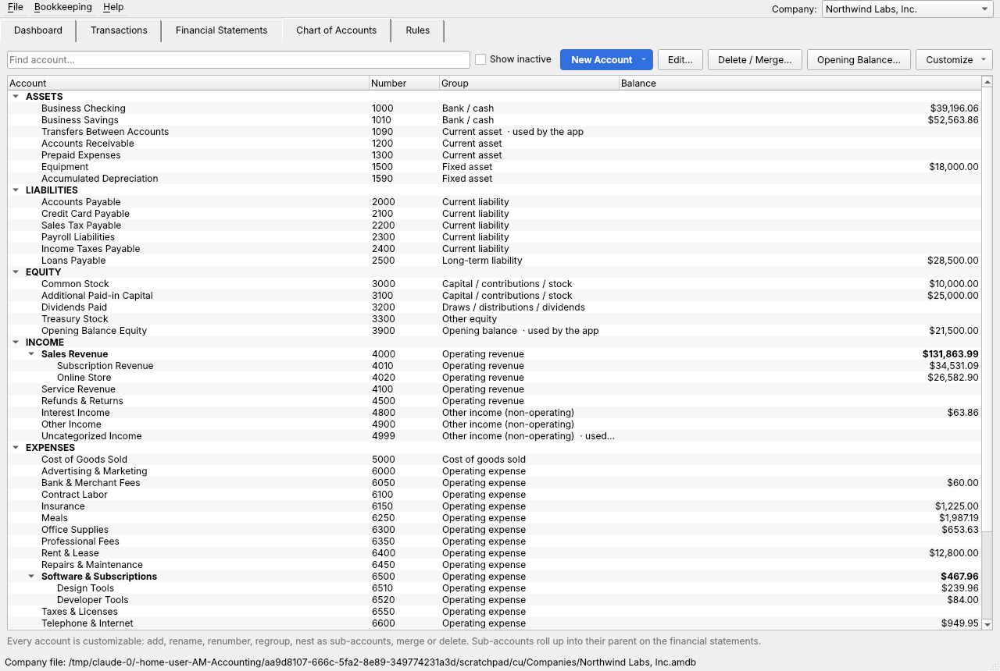

- **Add accounts of any type** (*New Account*): pick the type and the group
  that decides where it appears on the statements: bank/cash, current, fixed or
  other long-term assets; current or long-term liabilities;
  capital/stock, draws/dividends, retained-earnings adjustments or other
  equity; operating or non-operating income; cost of goods sold, operating or
  non-operating expenses.
- **Sub-accounts**: nest accounts under a parent (e.g. *Sales Revenue →
  Subscription Revenue, Online Store*; *Software → Design Tools, Developer
  Tools*). Statements show them indented with a subtotal for the parent;
  category drop-downs show them under the parent.
- **Rename, renumber, regroup, deactivate** any account — including the ones
  the app relies on (Uncategorized, Opening Balance Equity, Transfers), which
  are tracked by a permanent internal key rather than their number or name.
- **Delete / Merge**: unused accounts are deleted; accounts with history are
  merged into another account (all transactions, ledger entries and rules move
  across).
- **Statement headings** (*Customize → Financial statement headings*): rename
  any heading — *Revenue → Net Sales*, *Operating Expenses → Selling, General &
  Administrative*, *Equity → Shareholders' Equity*, and so on. Defaults follow
  the business type: Shareholders' Equity for corporations, Members' Equity for
  LLCs, Partners' Capital, Owner's Equity, or Net Assets for nonprofits.
- **Templates for new companies**: Standard small business; Corporation
  (Common Stock, Additional Paid-in Capital, Dividends Paid, Treasury Stock,
  income tax accounts); LLC (Member Contributions / Distributions); Retail /
  e-commerce (Inventory, freight and processing in cost of goods sold); or
  Minimal to build your own. The template is suggested from the business type.
- **Edit in Excel**: *Customize → Export / Import chart of accounts (CSV)*.
  Columns: Number, Name, Type, Group, Parent Number, Bank Account, Active.
  Imports add or update by account number, never delete, and are
  all-or-nothing — if any row is invalid, nothing changes.
- **Built-in suggestions** can be turned off (*Customize → Use built-in
  category suggestions*) so only your own rules and history categorize
  transactions. When on, they follow the standard accounts even after you
  rename or renumber them.

| Balance sheet for a corporation | Income statement with sub-accounts and custom headings |
|---|---|
| 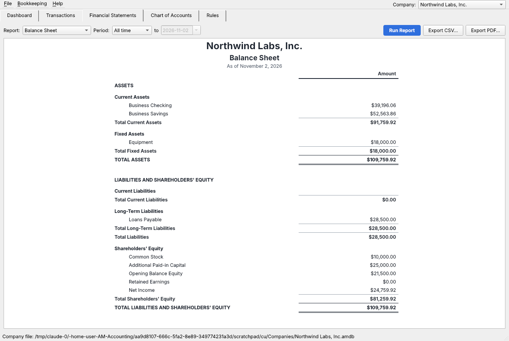 | 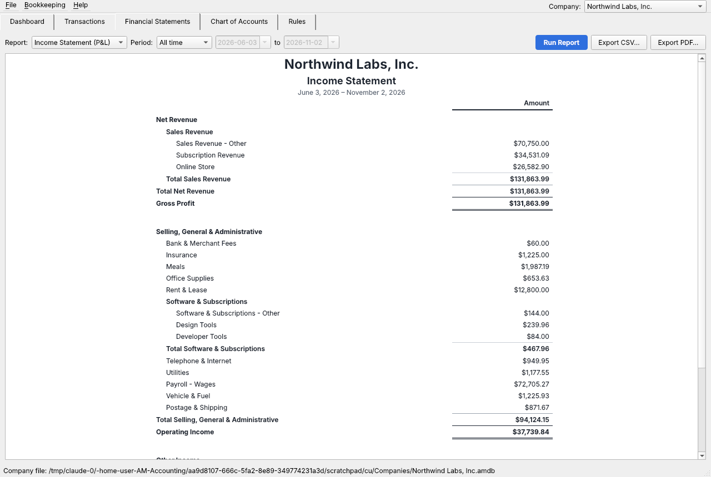 |

## Company folder & automatic saving

Each company gets one folder that AM Accounting organizes for you — choose it
when you create the company (or later: **File → Company Folder & Auto-Save…**,
or **Company Folder…** on the dashboard). **Use OneDrive** suggests
`OneDrive/AM Accounting/<Company>`.

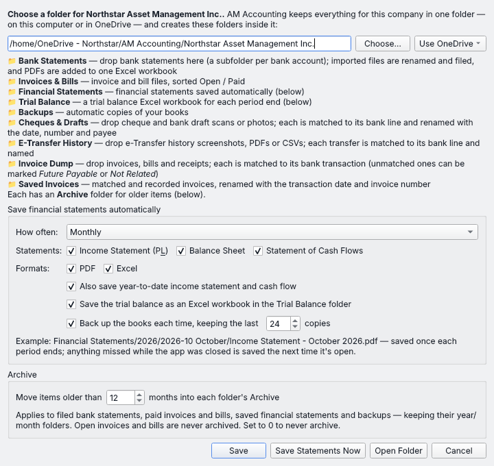

```
<Company folder>/
    Bank Statements/          drop statements here — one subfolder per bank account;
                              imported files are renamed and filed under Statements/,
                              and PDF statements also go into one Excel workbook
    Invoices & Bills/         invoice and bill files, sorted Open / Paid
    Financial Statements/
        2026/
            2026-10 October/
                Income Statement - October 2026.pdf / .xlsx
                Balance Sheet - 31 Oct 2026.pdf / .xlsx
                Cash Flow - October 2026.pdf / .xlsx
                Income Statement - Year to Date 31 Oct 2026.pdf / .xlsx
    Trial Balance/
        2026/Trial Balance - 31 Oct 2026.xlsx   trial balance workbook for each period end
    Backups/                  a copy of the books each time statements are saved
    Invoice Dump/             drop invoices, bills and receipts: matched to bank transactions
    Saved Invoices/           matched and recorded invoices, renamed by date and invoice number
    (each with an Archive/ folder for anything older than 12 months)
```

**Trial Balance**: at the end of each period (same schedule as the
statements) a trial balance Excel workbook is saved to
`Trial Balance/<year>/Trial Balance - 31 Oct 2026.xlsx`, with live formulas:

- *Trial Balance* — account number, name, type, debit, credit, totals and a
  difference check that should read 0.00 (filterable, header frozen);
- *Working TB* — opening balance, debits and credits for the period, closing
  balance and closing debit / credit;
- *Summary* — debits and credits by type (assets, liabilities, equity, income,
  expenses).

Switch it on or off in Company Folder & Auto-Save. To save one now, choose
**Trial Balance** on the Financial Statements tab and click **Save to Trial
Balance Folder** (or **File → Save Trial Balance to Excel**, Ctrl+Shift+T);
**Export Excel…** saves any statement to Excel wherever you like. Trial
balances older than the archive age move to `Trial Balance/Archive/`.

**Invoice Dump**: drop invoices, bills and receipts — PDFs, scans or phone
photos — into `Invoice Dump/`. Each one is read (OCR for scans and photos) for
its total, date, invoice number and the names on it, then matched to the bank
transaction of exactly that amount near that date (the invoice number or a name
from the document appearing in the bank description settles close calls):

```
Saved Invoices/
    2026/2026-10/2026-10-25 HS-44871 Harbor Supply Co.pdf               ← matched and recorded
Invoice Dump/
    Recognized/2026/2026-10/2026-10-18 Harbor Supply Co $374.92.pdf     ← matched, expense not recorded yet
    Not Yet Matched/IMG_2291.pdf                                        ← no bank payment yet
    Future Payables/2026-10-20 KP-2207 Keystone Printing $689.00 (due 2026-11-19).pdf  ← you: "not paid yet"
    Unrelated/wrong_invoice.pdf                                         ← you: "not ours"
```

For an invoice that isn't matched, choose in the Invoice Dump window:

- **Future Payable…** — it hasn't been paid yet. It's recorded as a bill in
  Accounts Payable (vendor, due date and expense account can be adjusted) and
  the file moves to `Invoice Dump/Future Payables/`, renamed with the invoice
  date, number, vendor, amount and due date. When its payment shows up in a
  bank statement the bill is marked paid and the invoice moves to
  `Saved Invoices/`.
- **Not Related** — a wrong invoice, someone else's, or personal. The file
  moves to `Invoice Dump/Unrelated/`, stays out of the books and is never
  matched.

**Undo** puts either back in *Not Yet Matched* (removing the bill from Accounts
Payable if nothing has been paid on it).

Once an invoice is matched **and** its payment has an expense category, it is
moved to `Saved Invoices/<year>/<month>/` and renamed with the transaction
date and the invoice number (`2026-10-25 HS-44871 Harbor Supply Co.pdf`; if no
number could be read, the amount is used instead). Matches whose payment is
still uncategorized wait in *Recognized* and move automatically as soon as the
payment is categorized (on the next scan or **Process All Bills**). Undoing a
match moves the file back to *Not Yet Matched*.

Matched files are linked to their transaction (📎 in the Transactions list;
*Open 📎* opens the file). Files waiting in *Not Yet Matched* are checked again
after every statement import, so an invoice dropped before its payment clears
is recognized automatically later. **Bookkeeping → Invoice Dump…** (Ctrl+Shift+D)
lists everything with what was read, and lets you match by hand when two
payments have the same amount, correct a misread total or date, or undo a
match. Identical files and re-sent copies of the same invoice (same number and
total) are not filed twice. The dashboard shows how many are waiting.

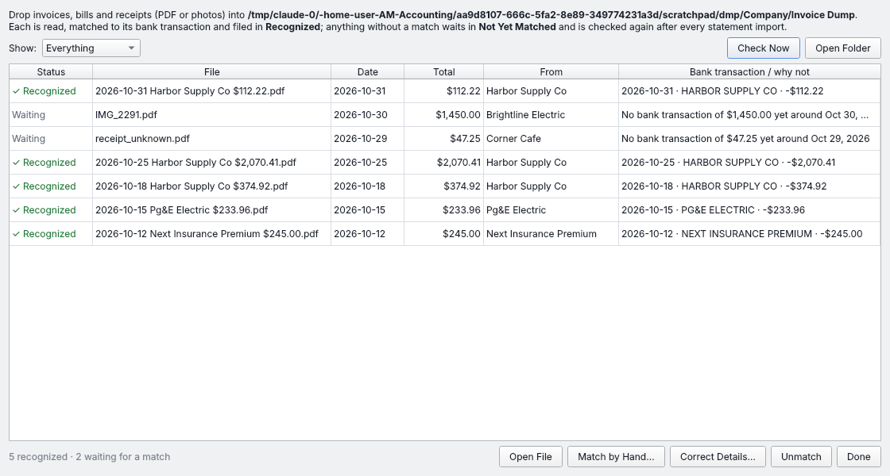

**Process All Bills** (dashboard button, the Invoice Dump window, or
**Bookkeeping → Process All Bills**, Ctrl+B) works through everything in the
Invoice Dump in one go, with a progress bar:

1. reads every new file and matches it to its bank payment;
2. records the expense — a matched payment without a category gets one from
   its bill (your rules and past choices for that vendor first, then the
   built-in suggestions);
3. bills with no bank payment yet are recorded as **future payables** in Accounts
   Payable (vendor, number, date, due in 30 days, amount, expense account) and
   their files move to *Future Payables*; when the payment shows up in a
   statement the bill is marked paid automatically (switch this off with
   *Record unpaid bills in Accounts Payable*);
4. shows a summary, listing anything that needs you — e.g. two payments of the
   same amount, or a file whose total couldn't be read.

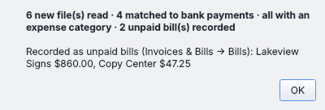

**Archive**: each of the folders has an `Archive/` folder. Anything dated
more than **12 months** ago (change it, or set 0 for never, in the same window)
moves there automatically, keeping its year/month folders — filed bank
statements (by the period they cover), *paid* invoices and bills (by issue
date; open ones always stay put), saved financial statements (by period) and
backups. The running Excel workbook of PDF statements stays where it is.

**Saving schedule**: daily, weekly (Monday–Sunday), monthly, quarterly or
yearly. When a period ends, its statements are saved once — choose which ones
(income statement, balance sheet, cash flow, trial balance), PDF and/or Excel,
and whether to add year-to-date versions. If the app was closed when a period
ended, it catches up the next time it's opened. *Save Statements Now* saves the
latest period immediately. The dashboard shows the folder and the next save date.

## Light and dark mode

The app follows Windows' light/dark setting, or choose **View → Appearance →
Light / Dark / Match System**. Colours for money in/out, warnings and links are
tuned for each, and financial statements are always shown on a white page (as
they print and export).

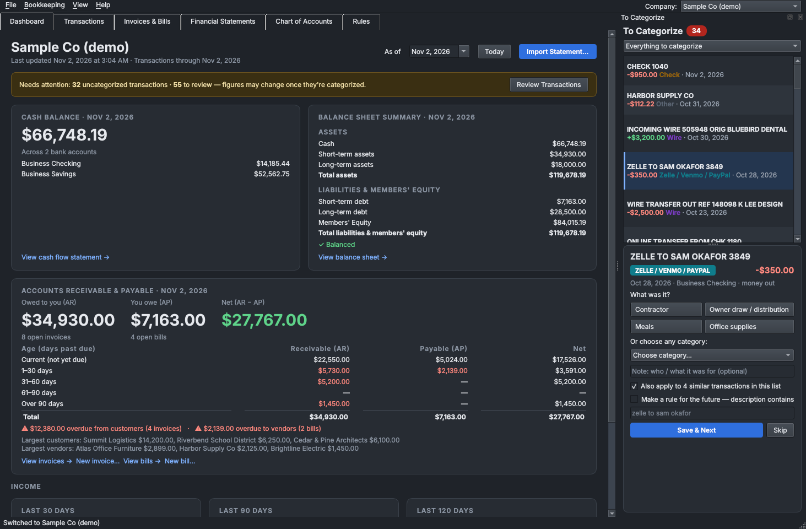

## Dashboard

The first screen when the app opens:

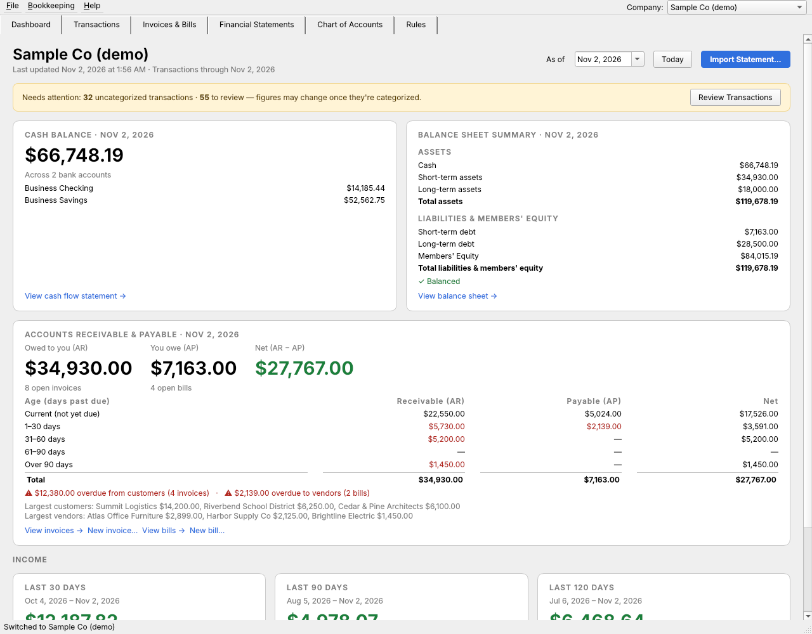

- **Last updated** — when statements were last imported, how recent the
  latest transaction is, and a warning when the books are more than a week behind.
- **Cash balance** — total across all bank accounts, with each account listed.
- **Balance sheet summary** — assets split into cash, short-term assets
  (receivables, prepaid, inventory…) and long-term assets (equipment and other
  long-term assets), then short-term debt (payables, credit cards, taxes due…),
  long-term debt (loans) and equity, with totals and a check that they balance.
  Which group an account counts in follows its group in the Chart of Accounts.
- **Accounts receivable & payable** — one card with what customers owe you
  (AR), what you owe vendors (AP) and the net, and an aging table showing AR, AP
  and net side by side for current, 1–30, 31–60, 61–90 and over 90 days past
  due, plus overdue totals, the largest customers and vendors, and links to view
  or add invoices and bills.
- **Income** — revenue, expenses, net income and profit margin for the last
  30, 90 and 120 days.
- **Needs attention** — uncategorized and unreviewed transaction counts, with
  a button to jump straight to them.

Change the **As of** date to see the dashboard at any past date. Every card
links to the full statement for the same period. To try it with realistic
data, use **Help → Create Sample Company**.

## “To Categorize” side panel

Bank descriptions like *WIRE TRANSFER OUT REF 88123*, *ONLINE TRANSFER*,
*ZELLE TO J MARTINEZ*, *CHECK 1042* or *MOBILE DEPOSIT* don't say what the
money was for. They're collected in a **To Categorize** panel on the right of
the window, available from every tab (**Bookkeeping → Show “To Categorize”
Panel**, Ctrl+K; it opens automatically after an import that adds some):

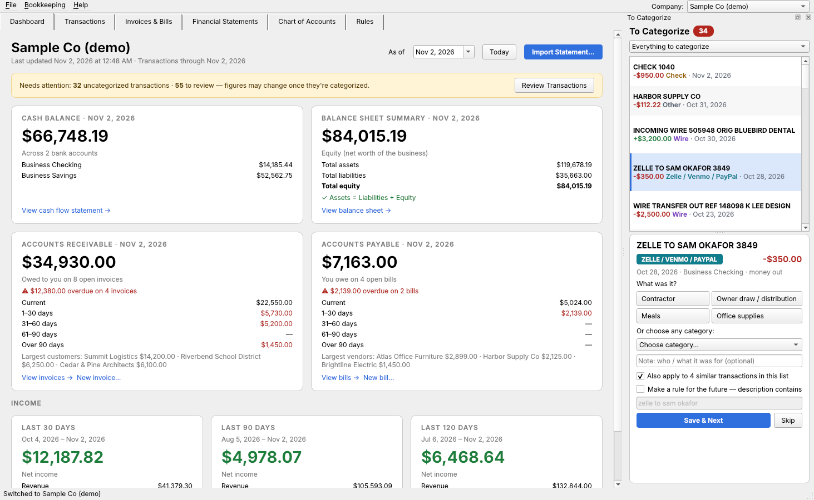

- Lists every **uncategorized** transaction, plus transfers, wires, ACH,
  Zelle/Venmo/PayPal, checks, ATM/cash and plain deposits whose category was
  only **guessed** — so you confirm or correct them. Each is tagged with its
  kind (Wire, Transfer, Check #1042 …). Filter by kind at the top.
- **One-click answers** that fit the kind of transaction (for an outgoing
  transfer: *to another of my accounts*, *owner draw*, *credit card payment*,
  *loan payment*; for an incoming wire: *customer payment*, *owner
  contribution*, *loan received* …), or choose any category.
- **Note** what it was for (saved as the transaction's memo).
- **Apply to similar** transactions from the same source in one go.
- **Make a rule** so future look-alikes are categorized automatically
  (suggested from the description, e.g. “zelle to j martinez”; not offered
  for checks, which differ every time).
- If a deposit or payment **matches an open invoice or bill** by amount, a
  button records it as that payment.
- *Guess is right* accepts the suggestion; *Skip* moves on. *Save & Next*
  goes straight to the next one.

## Invoices & bills (accounts receivable / payable)

### AR & AP tab

The **AR & AP** tab (next to the Dashboard) lists every outstanding invoice
(owed to you) and bill (you owe), line by line: customer / vendor, AR / AP
account, number, **invoice / bill on file** (✓ Attached, ✓ Created in app, or
✗ Missing), date, due date, days overdue, aging bucket, amount, paid, balance
and description — with totals, aging (Current, 1–30, 31–60, 61–90, 90+) and
the net position (owed to you − you owe) at the top.

- Amounts posted **straight to the AR / AP accounts** — bank transactions
  categorized to Accounts Receivable / Payable, opening balances and journal
  entries — are listed line by line too (*No invoice (bank entry)* etc.), so
  the total always equals the balance in the books. Received e-Transfers and
  cheques show who they were from; **Name Customer… / Name Vendor…** names any
  line, and **Attach** works on these lines as well (files go to
  `Invoices & Bills/AR-AP Support/`). Accounts you created whose name includes
  *Receivable* or *Accounts Payable* are included.
- **Group** by customer / vendor (default), by AR / AP account, or line by
  line (customer A–Z); **Show** all, overdue only, or only items missing their
  invoice / bill; search; and an **As of** date for any past date.
- **Attach Invoice… / Attach Bill…** copies the PDF, scan or photo into
  Invoices & Bills (renamed and sorted) and the row turns ✓ Attached;
  **View Invoice / View Bill** opens it. Bills recorded from the Invoice Dump
  count their file in *Future Payables*.
- **Record Payment…**, **Edit…** (double-click), **New Invoice… / New Bill…**.
- **Export Excel…** — Receivable and Payable sheets with every open item, the
  file status, totals and aging (formulas).

### Cheques & bank drafts

Statements show cheques and drafts as `CHQ#00126-9000000001` or
`CAD DRAFT 05551234` — no payee. Save a scan or photo of the cheque, the
bank's cheque image (PDF), or the bank draft receipt in the company folder's
`Cheques & Drafts/` folder, or use **Bookkeeping → Cheques & Drafts… → Add
Files…** (Ctrl+Shift+Q). Each one is read (PDF text or offline OCR) for the
cheque / draft number (printed number, MICR line or file name), *pay to the
order of*, amount, date (including date boxes like `2 0 2 4 0 4 1 0`) and memo,
then matched to the statement line with the same number and amount (or, with no
number, the same amount within 90 days — cheques can be cashed late):

```
Cheques & Drafts/
    Matched/2024/2024-04/2024-04-15 Cheque 126 Jane Smith $4,982.50.jpg
    Matched/2024/2024-04/2024-04-09 Draft 5551234 Harbour Construction Ltd $12,134.95.pdf
    Not Yet Matched/scan0009.jpg        ← not in a statement yet; checked after every import
```

The transaction's memo shows `✎ Cheque #126 to Jane Smith “April rent”`, *Open
📎* in Transactions opens the scan, the category you used for that payee before
is applied, and a cheque / draft for exactly an open bill of that payee pays
it. **Match by Hand…**, **Correct Details…** and **Unmatch** fix anything
misread; *Who was this cheque / draft?* in the To Categorize panel opens the
window. Matched items older than the archive age move to `Cheques &
Drafts/Archive/`.

### Accounting and Asset Management

At the top of the window, pick a company from the **Company** drop-down. Next
to it are two tabs for that company (Ctrl+Shift+M switches between them):

- **Asset Management** shows the company inside the portfolio. An operating
  company opens on its Company Overview (value, debt, NAV, operations, cash
  flow, returns, financing, month by month, projections), with its Customers &
  Vendors, Projections and Waterfall a tab away. A holding company opens on its
  shareholdings, and an asset manager on its managed companies. The
  **Viewing** drop-down still shows the whole portfolio.
- **Accounting** is the company's bookkeeping.

Picking another company keeps you on the same tab and shows that company's
screen.

**Operating companies are pulled in automatically.** With **Pull in all
operating companies** ticked (the default), every company set up as an
operating company appears in the portfolio as a holding linked to its books, so
its revenue, Op. Ex, EBITDA, Non-Op. Ex, capex, cash, debt and book value show
up with no typing. It starts at 100% owned by the portfolio's holding company.
Use **Edit…** to set the ownership %, holding company, asset manager or
valuations. If you delete one, or unlink its books, it stays out. To bring
those back, untick and re-tick the box. Holding companies and asset managers
are never added as holdings.

**Property pages.** For each operating company, Asset Management has these
tabs, kept in step with its books:

- **Dashboard**
  - Left: the property and address, then a timeline. It shows closing, each
    loan's funding and maturity, your own milestones with original and current
    dates (late ones in red), and the exit date. Below that are value, debt and
    NAV, then invested, distributions, profit, MOIC and IRR.
  - Middle: rental status (EGI, Op. Ex and NOI for the last 12 months, the
    current run-rate and the next 12 months projected). Then construction
    status (budget, cost to date and cost to complete by group, from CapEx) and
    this month's cash: starting cash, rent collected, operating costs, capex,
    debt service, equity, debt, working-capital change and ending cash.
  - Right: rental status by unit type (old-lease and renovated units with their
    average rents, and market rent), a leasing update (available units and
    market rate by type), and a **Weekly Activity** notes box.
- **Rent Roll & Operations**
  - The rent roll: unit, tenant, type, size, status, rent, parking, locker,
    market rent, move-in, lease end (a date or MTM) and notes. Add units by
    hand, or use **Import Rent Roll…** to read a rent-roll table from an Excel
    workbook or CSV.
  - Figures: units, occupancy, in-place rent, average vs market rent, loss to
    lease, MTM leases and those expiring in 90 days, NOI and DSCR.
  - **Unit Mix**, plus a **Monthly Operating Statement** with months across
    and categories down. Past months are the books, account by account. The
    next 12 months are projected: rent from the rent roll, going up by the
    annual increase on each move-in anniversary, less the vacancy allowance.
    Other lines use the same month last year, so seasonal costs stay seasonal.
  - Below: NOI, debt service (from the loans), cash flow after debt service
    and DSCR.
- **Cash Flow**
  - Monthly: NOI, capex, debt service, loan advances, equity injections (from
    the cap table's funding dates), distributions, net cash flow, and opening
    and ending cash.
  - Actual months end at the bank balance in the books. Receivables, payables
    and timing differences show as *Other / working capital*. Projected months
    carry the balance forward and spread the capex cost to complete evenly.
- **CapEx**
  - A capital budget by group: hard costs, fees, soft costs, closing costs,
    acquisition and interest. Each line has a budget, cost to date, cost to
    complete and % complete. **Start from Template** adds the usual items.
  - Link a line to an account in the books, or use **Create Account in the
    Books** to add one such as *CapEx – Roofing*. Then categorizing a
    contractor's payment to that account updates the cost to date and the
    monthly spending table. Costs not in the books can be entered by hand.

**Financing & Cap Table.** This Asset Management tab has a page for each
company:

- **Loans:** each loan's lender name, facility (mortgage, term loan, line of
  credit…), type (**amortizing** or **interest only**), principal, balance,
  interest rate (fixed / variable), term, payment, annual debt service,
  annual interest, maturity and time left. Debt accounts in the company's books
  show up automatically; double-click one to add its terms. Where a loan is
  linked to an account in the books, its balance is read from them.
- **Loan window:** enter the lender name, principal, interest rate, type, start
  date, **term**, **amortization period** (amortizing loans; e.g. a 5-year term
  amortized over 25 years) and **payment period** (monthly, bi-weekly,
  quarterly, semi-annual, annual or at maturity). The payment and maturity are
  worked out for you, or tick *Enter by hand* to type your own payment. The
  window also shows the yearly debt service, total interest over the term, the
  balloon at maturity and the scheduled balance today (**Use Scheduled** copies
  it into the balance).
- **Amortization table:** for the selected loan, every payment with its date,
  interest, principal and balance left, then the balloon owed at maturity and a
  total. Switch between *Each payment* and *By year*.
- **Capital stack:** debt from most senior down, then equity, each as a % of
  total capitalization, with the cumulative loan-to-value.
- **Cap table (debt & equity):** the owners by **share class**. Each owner
  has a name, the company they hold through (if any), equity, % owned (their
  equity ÷ the total), amount funded and funding date, with subtotals per
  class and the value of each stake. Overfunding shows on the class subtotal.
  **Import Equity…** reads an equity table laid out with class headings
  ("Class A Shares") followed by Name of Investor / Name of Corporation /
  Equity / Funded rows. Until you enter owners, the table is worked out from
  the holding's ownership %.

**Loans in the accounting.** Loans entered on Financing & Cap Table connect
to the company's books:

- **Create Account in the Books** (Financing & Cap Table, or Accounting →
  Transactions → **Loans…**) adds a liability account for the loan, such as
  *Mortgage – TD Bank*, and links it to the loan. If the loan is older than the
  books, the account gets an opening balance equal to the scheduled balance on
  the books' first day.
- **Transactions → Loans…** lists the company's loans and the bank lines that
  look like their payments: the same amount as the loan payment, or the
  lender's name plus a word like MORTGAGE / LOAN / MTG. A deposit for the loan
  amount near its start date is suggested as the loan advance. Tick and click
  **Record Ticked**.
- **Payments are split.** The **principal** lowers the loan's balance in the
  books, and the **interest** goes to *Interest Expense* (created if needed).
  Interest is the balance owed in the books before the payment × the rate for
  one payment period. Payments are recorded oldest first, so each uses the
  balance the last one left.
- **Any bank line by hand.** Double-click it in Transactions and click
  **Loan Payment…**: pick the loan, and correct the interest to match the
  lender's statement if needed. Changing the transaction's category later
  replaces the split.
- In Transactions, the category of a split payment shows both parts (e.g.
  *Mortgage – TD Bank $4,109.95 + Interest Expense $7,875.00*), and the source
  shows **Loan**.
- **What updates.** The loan's balance on Financing & Cap Table comes from the
  books, so it falls as payments are recorded. The amortization table ticks
  each scheduled payment recorded in the books (✓ date and interest) and opens
  at today. The interest flows into the income statement and Non-Op. Ex, and
  the principal into the balance sheet and cash flow.

**Company Overview** keeps a summary of all the loans (lender, facility, type,
balance, rate, payment, maturity). **Financing & Cap Table →** or a
double-click on a loan opens the full page. Loans that aren't in the books are
added to the company's Debt. The Portfolio Summary shows each company's
lenders, principal, balance, weighted interest rate, annual interest and next
maturity. A maturity less than a year away shows in red.

**Sources & uses.** The Portfolio Summary also has a sources & uses table for
each company (100%) and for the portfolio (our share):

- **Sources:** debt financing (the loans' principal), our equity (the capital
  we put in), the other owners' equity (pro rata) and other sources.
- **Uses:** purchase price (from a *Purchase price* valuation), capex /
  improvements since acquisition (from the books), closing & financing costs,
  and cash reserve / other. Cash reserve / other balances the two sides.

Double-click a company's column to type in its own figures. **Balance with Cash
Reserve** evens the two sides, and **Work Out Automatically** goes back to the
worked-out figures.

**Changing a company's type.** Click **Change Type…** next to the company's
type at the top of the window, or in **Manage Companies…**. Pick operating
company, holding company or asset manager; it adds the accounts that type
needs. For example, an asset manager that was set up as an operating company
can be switched to an asset manager.

**Viewing.** In Asset Management, the **Viewing** drop-down is grouped like
the Company list. You can pick:

- **All operating companies**, or one operating company;
- **All holding companies** (every holding owned by a holding company), or one
  holding company's shareholdings;
- **All asset managers** (every company with an asset manager), or one asset
  manager's companies.

Every tab follows it. Viewing one operating company shows it on Company
Overview, Customers & Vendors and Financing & Cap Table. Company Overview no
longer has its own company drop-down; its title shows which company it is.

**Grouped company list.** The Company drop-down and Manage Companies list the
companies under **Operating companies**, **Holding companies** and **Asset
managers**.

**What's in the portfolio.** Holding companies and asset managers own and run
the portfolio; they aren't part of it. A holding linked to a holding
company's or an asset manager's books is left out of the Portfolio Summary,
the company drop-downs in Asset Management, Consolidated Financials, the
portfolio totals, projections and the waterfall. That includes holdings
pulled in before the company's type was set.

**Company types.** Each company is created as one of:

- **Operating company** — a business that sells goods or services (the usual
  bookkeeping).
- **Holding company** — holds shares of operating companies. It gets
  *Investments in Subsidiaries*, *Due from / Due to Related Parties*, *Dividend
  Income* and *Management Fees from Subsidiaries*; its books record the money it
  sends to and receives from the companies it owns.
- **Asset manager** — assigned to manage operating companies for a fee. It gets
  *Management Fee Income*, *Performance Fees / Carried Interest*, *Fees
  Receivable*, *Fund Expenses Recoverable* and *Investments in Managed Funds*.

The type is chosen in **New Company** (and can be changed in Company Settings);
it shows in the company switcher (*HoldCo*, *Asset Mgr*), and a holding
company's or asset manager's books show a bar linking to its shareholdings or
managed companies in Asset Management.

**Holdings.** Each operating company in the portfolio records: which **holding
company holds its shares** and the ownership %; its own **company books** (its
revenue, net income, cash, debt and equity are read from them — and its book
equity is the value until a valuation is recorded; **Create Books…** starts a
new company file for it); and the **asset manager** assigned to it with the
management fee (% of value per year and/or a fixed monthly fee).

**Integration with the books.** Tick the holding company's accounts for each
company (**Create "Investment in …" Account** adds one): money the holding
company sends to it becomes a contribution, money back a return of capital, an
opening balance the acquisition, and dividend income a distribution — read
straight from the holding company's books, marked *(books)*. Contributions and
distributions can also be entered by hand. **Open Company Books** jumps to the
company in Accounting.

**Asset Management screen.** *Viewing:* all holdings, one holding company's
shareholdings, or one asset manager's managed companies.

- **Portfolio Summary** — four groups, in this order: **1. Value** (value, debt,
  NAV — our share; 100% and loan-to-value underneath), **2. Operations**
  (revenue, Op. Ex, EBITDA), **3. Cash flow** (Non-Op. Ex, CapEx, net cash
  flow), **4. Returns** (MOIC, IRR, cash on cash return = our share of the net
  cash flow ÷ capital invested); allocation by type and by holding; and a
  summary table read top to bottom — one column per company (100%) and a
  *Portfolio (our share)* column, one row per figure. Double-click a company's
  column for its overview.
- **Company Overview** — one operating company in the same four groups (value,
  debt and our NAV; revenue, Op. Ex, EBITDA; Non-Op. Ex, CapEx, net cash flow;
  MOIC, IRR, cash on cash return);
  who holds it and who manages it (and the fee); a 12-month revenue / net income
  chart from its books; and its valuation history.

  *Definitions (last twelve months, from the company's books):* Op. Ex = cost of
  sales + operating expenses excluding depreciation & amortization; EBITDA =
  revenue − Op. Ex; Non-Op. Ex = interest, income taxes and other non-operating
  expenses (excluding D&A); CapEx requirement = the annual amount set on the
  holding, else the last twelve months' purchases of fixed assets; net cash
  flow = EBITDA − Non-Op. Ex − CapEx requirement; annual cash flow = the change
  in the company's cash. Valuations record the **company value** and **debt in
  place** (prefilled from its books); equity value = company value − debt, NAV =
  equity × ownership.
- **Waterfall (LP / GP)** — for each holding company (all its holdings
  together, or deal by deal) and for the **overall project** (every holding
  company under its own terms, added up): a hypothetical sale today — everything
  distributed so far plus today's NAV — split between the LPs and the GP in four
  tiers: 1. return of capital, 2. preferred return (on each contribution from its
  date, compounding annually), 3. GP catch-up, 4. carried interest. Shows what
  goes to the LPs and the GP in each tier, the GP promote (catch-up + carry), and
  LP and GP multiples and IRRs. **Terms** per holding company: LP share of the
  capital (the rest is the GP's commitment), preferred return %, catch-up %,
  carried interest % and the GP (default: the asset manager).
- **Projections** — future years for each company: revenue, Op. Ex, Non-Op.
  Ex and **CapEx spend** (EBITDA and net cash flow are worked out), entered in
  **Projections…** (Company Overview or this tab) — type each year, **Add Year**
  (copies the last one forward), or **Fill from Last 12 Months…** with growth
  rates and an annual CapEx. Shown next to the last 12 months actual, for one
  company (100%) or the portfolio (every company at our share, added up). Next
  year's projected CapEx is used as the CapEx requirement unless one is set on
  the holding.
- **Holdings** — add / edit holdings; for the selected one: its valuations
  (appraisal, purchase price, DCF, market multiple, book value…), capital flows,
  and figures from its books.
- **Consolidated Financials** — each linked company's revenue, net income,
  cash, receivables, assets, payables, debt, liabilities and equity, and the
  portfolio total at the ownership share.
- **Managed Companies** — for an asset manager: the companies it manages, who
  holds them, value (assets under management), fee %, fixed fee, annual fee,
  and fees billed and paid; **Bill Management Fees…** invoices each company for a
  period in the asset manager's books (Management Fee Income; the company becomes
  a customer; a period is never billed twice).
- **Export Excel…** — holdings with returns and financials, and all capital
  flows.

The portfolio is kept in its own file next to the company list, so it spans
every company.

### Searching and drilling down

The **Transactions** search box matches the description, memo, **category**
(name or number — *bank and merchant fees*, *Bank & Merchant*, *6050*,
*uncategorized*), name, bank account, amount (*12.76*, *3,000.00*) and date;
several words must all match.

On the **Financial Statements** tab, every account on the income statement,
balance sheet and trial balance is clickable: click **▸ Bank & Merchant Fees**
and it expands into the individual entries that make up the amount (date,
description, who / memo, amount), click again to collapse; **Expand All** /
**Collapse All** do every account. Balance sheet accounts show every entry up
to the date. **Export PDF…** includes whatever is expanded.

### Time across the top, categories down

Every view lays out time horizontally and categories vertically:

- **Financial Statements → Columns:** *Total only*, *By week*, *By month*,
  *By quarter* or *By year*. The income statement and cash flow get one column
  per period plus a **Total**; the balance sheet shows the balance at each
  period end. Expanded accounts put each entry in its period's column, and
  Excel / CSV / PDF exports keep the same layout (up to 60 columns).
- **Asset Management → Company Overview:** a month-by-month table (last 12
  months + Total) of Revenue, Op. Ex, EBITDA, Non-Op. Ex, CapEx, Net cash flow
  and Net income; **Projections** show future years across the top.
- **Consolidated Financials:** categories down the side, one column per company
  plus *Portfolio – our share*.

### Entering transactions and journal entries by hand

The **Transactions** tab has two ways to enter accounting by hand:

- **Add Transaction…** is for a bank or cash transaction that isn't on a
  statement: a cash sale, a cheque that hasn't cleared yet, a missing line.
  Enter the date, account, money in or out, amount, description, category,
  customer / vendor and a note. It's marked **✎** in the list. Double-click it
  and use **Change Date / Amount…** to correct it later. If an imported
  transaction in the same account has the same amount within 5 days, you're
  warned it may be a duplicate.
- **Journal Entries…** is for entries with debit and credit lines that don't
  go through a bank: depreciation, accruals, corrections, reclassifications.
  Add as many lines as you need, and Save only works once the debits and
  credits balance. The window lists every hand-made entry so you can change or
  delete it. They flow into the financial statements like everything else.

### Editing a transaction

**Double-click any transaction** in the Transactions list (or click an entry
under an expanded account on a financial statement) to open it: set the
**customer / vendor** (pick from the Customers & Vendors list, type a new name
— it's added to the list — or **New Customer / Vendor…**), optionally *also for
future transactions containing* the stable part of the description, change the
**category** (with a one-click **Use Due from …** for the contact's own
account) and the note. The Transactions list has a **Customer / Vendor**
column, and **Set Customer / Vendor…** names several selected transactions at
once.

### Customers & vendors

The **Customers & Vendors** tab is the list of everyone you deal with —
customers, related entities, shareholders, suppliers, contractors, lenders —
with, for each: customer / vendor / both, type, their **receivable account**
(Accounts Receivable, or their own *Due from Sister Co* — **Make "Due from …"
account** creates it for related entities and shareholders) and **payable
account** (Accounts Payable or *Due to …*), usual income / expense account,
**other names** (how the bank, e-Transfers and cheques show them, e.g.
`PRIYA SHAH`), email, phone and address. It shows what each owes you / you owe
and how many bank transactions carry their name; **Show Transactions** opens
them. The list starts from the customers and vendors on your invoices and
bills, and new invoices / bills add to it.

The list is used everywhere: names on e-Transfers, cheques and transfers
resolve to the contact; To Categorize offers the contact's accounts as
one-click choices (*Due from Sister Co Ltd*); new invoices and bills default to
the contact's account and usual income / expense account. In the **AR & AP**
tab, select one or more lines (or a group heading) and click **Assign to
Customer… / Assign to Vendor…** to assign invoices, bills, bank entries and
opening balances to a contact — optionally moving them into the contact's own
account (e.g. from Accounts Receivable to *Due from Sister Co*).

### Names (who a transaction was with)

e-Transfers, cheques, bank drafts, transfers and wires get a **name** — the
person or company the money went to or came from:

- from a matched **e-Transfer** (sent to / received from) or **cheque / draft**
  (pay to the order of);
- set by you in the To Categorize panel (**Name:** … **Set Name**), the AR & AP
  tab (**Name Customer / Vendor…**) — the same name shows everywhere;
- or from a **name rule**: tick *Also for future transactions containing*
  (e.g. `TFR-FR 7340218` → *Alex Morgan*) and every past and future transaction
  with that text gets the name as soon as it's imported.

The **To Categorize** panel has a **Name** filter (*Alex Morgan (6)*, *No name
yet*…) and **Group by name**; *Also apply to N others with Alex Morgan* puts one
category on all of them at once. The **Transactions** tab has the same Name
filter and shows 👤 names. Once you've categorized transactions with a name,
new ones with that name get the same category automatically (separately for
money in and money out), and bank lines in AR & AP use the names too.

### e-Transfer history

Bank statements show Interac e-Transfers as `SEND E-TFR ***k9q` or
`E-TRANSFER ***r2T` — no name. **Bookkeeping → e-Transfer History…**
(Ctrl+Shift+E, or *Who was this e-Transfer?* in the To Categorize panel) reads
your online-banking e-Transfer history from a **screenshot or photo** (offline
OCR), a **PDF**, a **CSV / Excel** export, or **pasted text**, and matches each
transfer to its bank line by the reference-number ending (`…k9q`), amount,
direction and date. Files can also be dropped into the company folder's
`E-Transfer History/` folder (read files move to `Read/`).

A matched transaction's memo becomes `↔ e-Transfer to Jane Smith “April rent”`. In the **To Categorize**
panel, matched e-Transfers, cheques and drafts show who they were to / from
under the bank line, and the detail pane shows everything that was read
(name, amount, date, message or memo, reference / cheque number), with **Open
Scan** for cheques and drafts and **Not this one — Unmatch** if it's wrong.
Once you've categorized an e-Transfer to someone, later ones to the same person
get the same category; an e-Transfer from a customer (or to a vendor) for
exactly the amount of an open invoice (or bill) is recorded as its payment.
History read before the statement is imported is matched after the import.
Cancelled transfers are skipped and the same history read twice is kept once;
Every e-Transfer line in your statements is recognized — `SEND E-TFR` (sent),
`E-TFR … EPAY` / `E-TRANSFER` (received), and spellings like `ETFR`, `E TFR`,
`INTERAC`, `AUTODEPOSIT` — while `SEND E-TFR FEE` charges are not. In To
Categorize they have their own **e-Transfer** badge and filter (bank drafts
too), and the e-Transfer History window's *Bank e-Transfers with no history
yet* view lists every statement e-Transfer no history is matched to (double-click
to name it), with a count of all of them.
**Match by Hand…**, **Unmatch** and **Delete** fix anything unclear. Match by
Hand lists every bank line of the same amount within ±7 days of the
e-Transfer (adjustable), with how many days apart each is, and shows lines
already matched to another e-Transfer so a wrong match can be moved; tick
*Show e-Transfers of any amount* to see all e-Transfers around that date.

### Receivable / payable accounts

Each invoice and bill can be recorded in its own **Receivable account** /
**Payable account** — the main Accounts Receivable / Payable, a sub-account
(**New…** adds one such as *Accounts Receivable – Related Party*), or another
asset / liability account such as *Credit Card Payable* or *Due to
Shareholder*. The choice is remembered per customer and vendor, shown in the
*AR account / AP account* column, used by the invoice generator and Future
Payable, and included in the dashboard's AR / AP totals and aging. Changing it
later moves the posting and any recorded payments to the new account.

### Invoice generator

**Create Invoice** (dashboard), **Bookkeeping → New Invoice…** (Ctrl+Shift+N)
or **New Invoice** on the Invoices & Bills tab opens the invoice generator:

- **Bill to** — customer name (remembered with their email and address),
  invoice number (next `INV-` number filled in), date, terms / due date and an
  optional PO or job reference;
- **line items** — description, quantity, rate, income account and tax rate
  for each line; subtotal, tax (by rate) and total update as you type;
- **notes** for the customer;
- **Preview**, **Save**, **Save & Open PDF**, or **Save & Email…** (creates
  the PDF, opens an email to the customer with the invoice number, amount and
  due date filled in, and shows the PDF to attach; the invoice is marked sent).

**Invoice Settings…** (in the generator, or Bookkeeping menu) holds what's
printed on every invoice: your address, email, phone, how to pay (e-Transfer,
wire details…), a footer, the tax name (HST, GST, VAT, Sales tax) and default
tax rate and terms. Company name, legal name and tax ID come from Company
Settings.

Saving posts Dr Accounts Receivable / Cr each line's income account / Cr Sales
Tax Payable, puts the invoice in AR aging, and files the PDF in
`Invoices & Bills/Invoices/Open/` (moving to *Paid* when the customer's
deposit is matched).

**Revenue that's already in the bank** — a deposit with no invoice behind it —
shows **Create Invoice for This Deposit…** in the To Categorize panel. The
invoice is pre-filled with the deposit's date and amount and recorded as paid
by that deposit, so the income is counted once.

The **Invoices & Bills** tab tracks money owed to you and by you:

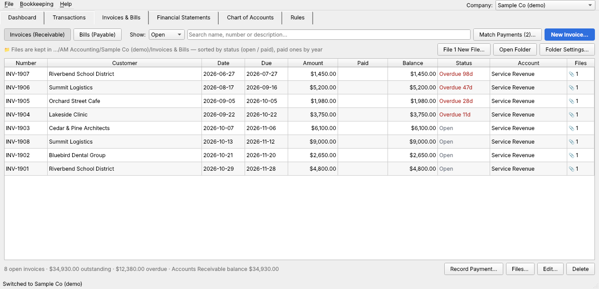

- **New Invoice / New Bill**: customer or vendor, number (invoices are
  numbered automatically), date, terms (due on receipt, net 15/30/45/60/90 or
  a custom due date), amount, and the income or expense account it belongs to.
  An invoice books the income and raises Accounts Receivable; a bill books the
  expense and raises Accounts Payable.
- **Record Payment**: when the money shows up in an imported bank statement,
  pick the matching transaction — the best matches (exact amount, invoice
  number or name in the description) are listed first. Partial payments and
  one deposit paying several invoices both work.

  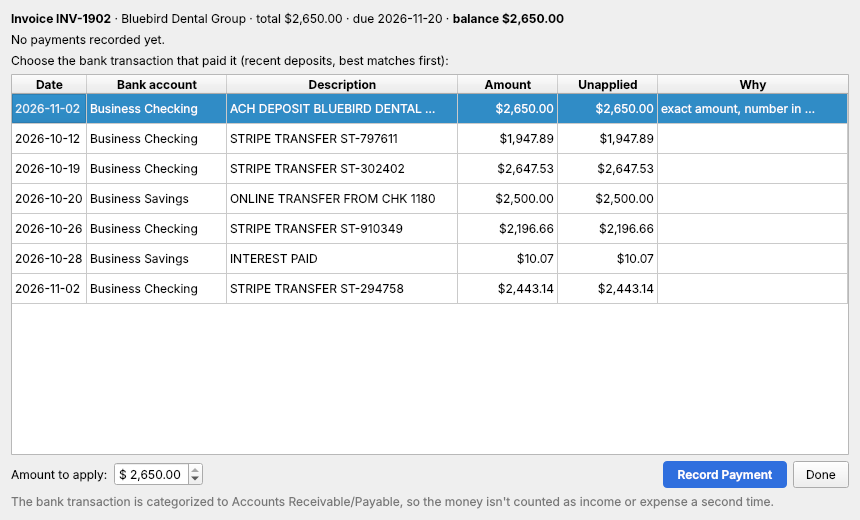

  The bank transaction is categorized to Accounts Receivable/Payable, so the
  deposit clears what the customer owed instead of being counted as income a
  second time. Recategorizing that transaction later unlinks it automatically.
- Filter by open, overdue, paid or all, and search by name, number or
  description. Status shows how many days overdue each one is.

### Matching every payment to its invoice or bill

After each statement import (manual or from the statement inbox) the app
matches bank transactions to open invoices and bills automatically when it's
confident — the amount matches exactly **and** the invoice/bill number or the
customer/vendor name is in the bank description, or it's the only payment of
that amount in the window after the invoice date. Less certain pairs (e.g. two
open invoices for the same amount, or a deposit you already categorized
yourself) are proposed in **Match Payments (n)…**, ticked or unticked by
confidence, for you to confirm:

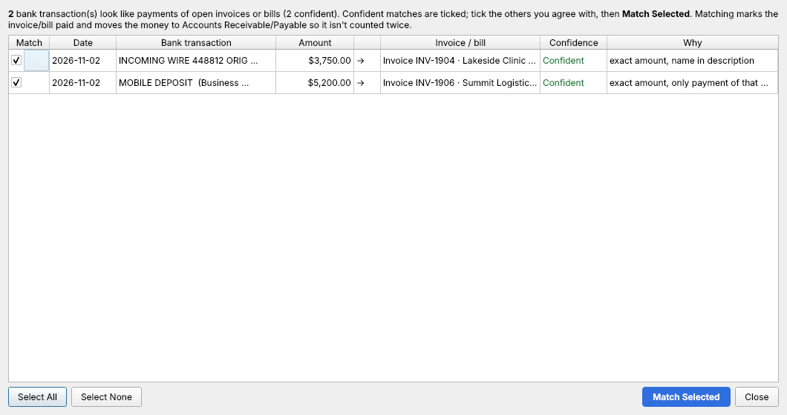

The dashboard's *Needs attention* bar shows how many payments are waiting to be
matched. Automatic matching can be switched off in *Folder Settings*.

### Invoice & bill folder (on this computer or OneDrive)

**Folder Settings…** on the Invoices & Bills tab picks a folder for every
invoice and bill file (**Use OneDrive** suggests
`OneDrive/AM Accounting/<Company>/Invoices & Bills`):

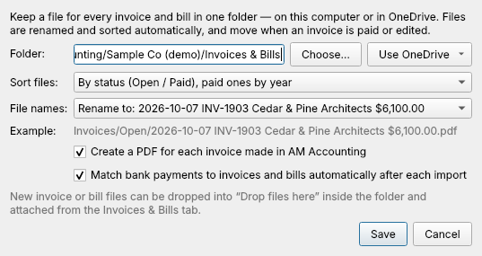

```
Invoices & Bills/
    Invoices/
        Open/
            2026-10-07 INV-1903 Cedar & Pine Architects $6,100.00.pdf
        Paid/
            2026/
                2026-09-22 INV-1904 Lakeside Clinic $3,750.00.pdf
    Bills/
        Paid/2026/2026-09-02 HS-43025 Harbor Supply Co $2,003.11.pdf
    Drop files here/      ← save new invoice/bill files here to attach them
    Removed/              ← files of deleted invoices/bills
```

- **Sorted** by status (Open / Paid, paid ones by year — files move to *Paid*
  the moment a payment is matched), by customer/vendor, by customer/vendor then
  year, or by year then month.
- **Renamed** to `date number customer amount`, `customer number date`,
  `number customer`, or kept as the original name. Edit an invoice (new
  customer name, date, amount…) and its files are renamed to match; change the
  layout and the whole folder is re-sorted; move the folder (e.g. into
  OneDrive) and the files go with it.
- **Invoice PDFs** are created for invoices made in the app (and updated with a
  PAID stamp when paid).
- **Attach** scans, vendor bills, receipts or contracts with **Files…** (📎
  column shows how many). Files saved into *Drop files here* appear as
  **File n New Files…**: attach each to an invoice/bill, or start a new bill
  from it.

## Multiple companies

Keep books for as many businesses (or clients, or your household) as you like.
Each company is fully separate — its own bank accounts, transactions, chart of
accounts, rules and reports — and lives in its own `.amdb` file, so it can be
backed up or handed to an accountant on its own.

- **File → New Company…** (Ctrl+N): name, legal name, business type, tax ID and
  fiscal year start month. *Start with* either the standard chart of accounts
  or a copy of another company's accounts and rules (bank accounts and
  transactions are never copied). New companies are saved in
  `Documents/AM Accounting/Companies` unless you choose another folder.
- **Switch** from the *Company* drop-down at the top right, or **File → Switch
  Company**. The app reopens the last company you used.
- **File → Companies…** (Ctrl+Shift+O) lists every company with its
  transaction count and date range, and lets you add an existing company file,
  remove one from the list (the file is kept), or permanently delete one
  (requires typing the company name).
- **File → Company Settings…** edits the current company's details. With a
  non-January fiscal year, *Year to date*, quarters and *Last fiscal year*
  follow it, and the balance sheet splits Retained Earnings / Net Income at the
  fiscal year start.

## Statement inbox (folder or OneDrive)

Import statements just by saving them into a folder — on this computer or in
OneDrive. Open **Bookkeeping → Statement Inbox (Folder / OneDrive)…**
(Ctrl+Shift+I), tick *Import statements from this folder automatically*, and
pick a folder with **Choose…** or **Use OneDrive** (which lists the OneDrive
folders signed in on this computer and suggests
`OneDrive/AM Accounting Inbox/<Company>`).

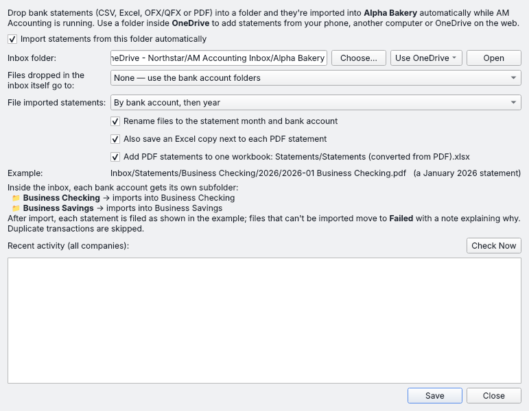

The app creates one subfolder per bank account:

```
AM Accounting Inbox/Alpha Bakery/
    Business Checking/   ← drop Checking statements here
    Business Savings/
    Statements/          ← imported statements, filed and renamed automatically
        Business Checking/
            2026/
                2026-01 Business Checking.pdf
                2026-01 Business Checking.xlsx   (optional Excel copy of each PDF)
                2026-02 Business Checking.pdf
        Business Savings/
            2026/
                2026-01 Business Savings.qfx
    Failed/              ← files that couldn't be imported, with a .error.txt note
```

**Filing imported statements.** After a statement is read, it is moved into
`Statements/` and renamed after the month it covers and its bank account
(statements spanning two months are named by date range, e.g.
`2026-01-15 to 2026-02-14 Business Checking.pdf`). Choose the layout under
*File imported statements*:

| Option | Example |
|---|---|
| By bank account, then year (default) | `Statements/Business Checking/2026/2026-01 Business Checking.pdf` |
| By year, then month | `Statements/2026/01 - January/2026-01 Business Checking.pdf` |
| By bank account only | `Statements/Business Checking/2026-01 Business Checking.pdf` |
| Keep as received | `Processed/Business Checking/<original file name>` |

Untick *Rename files* to keep the bank's original file names inside the chosen
layout, and tick *Also save an Excel copy* to get a spreadsheet version of
every PDF filed beside it. If the identical file is already filed it isn't
stored twice; a different statement for the same month is kept alongside as
`… (2).pdf`.

While the app is open it checks every company's inbox every few seconds,
waits until a file has finished copying or syncing, imports it (CSV, Excel,
OFX/QFX/QBO or PDF), auto-categorizes the new transactions, and leaves them
under *Needs review*. Duplicates are skipped, so dropping the same statement
twice is harmless. Files dropped straight into the inbox (not a subfolder) go
to the *default bank account* if you set one, otherwise to `Failed`. The
dashboard shows which folder is being watched.

**OneDrive**: the OneDrive app keeps a synced copy of your files in a normal
folder on the computer, so statements uploaded from your phone, another
computer or onedrive.com are imported the next time AM Accounting is running
here. If OneDrive's *Files On-Demand* is on, the app downloads each file when it
reads it. Dropbox, Google Drive and iCloud Drive folders work the same way.
Run AM Accounting on only one computer per company file so a statement isn't
imported into two copies of the books.

Each company has its own inbox folder (two companies can't share one). To
process inboxes without the app open:

```bash
python -m am_accounting.inbox "~/Documents/AM Accounting/Companies/Alpha Bakery.amdb"
```

Add `--once` to process what's waiting and exit.

## PDF statements → one Excel workbook

When you import a PDF statement (**Import Statement…**), the app also adds it
to a single workbook in the same folder as the PDF:
**`Statements (converted from PDF).xlsx`**. Import more PDFs from that folder and
they're added to the same file:

- **All Transactions** – every transaction from every PDF, sorted by date, with
  the bank account and source statement, filters and live totals.
- **Summary** – one row per statement: file, bank account, period, number of
  transactions, money in, money out, net change, when it was added.
- **One sheet per PDF** (named after the file) with that statement's
  transactions and totals.

Each new import adds to the same workbook — January to April today, May next
month — and the All Transactions and Summary sheets are rebuilt to include every
statement so far. Re-importing a PDF (e.g. a corrected statement) replaces its
sheet instead of adding a duplicate. A PDF that's already in your books can
still be added (the import button becomes *Add to Excel Workbook*). The option is
a checkbox in the import window and is remembered.

If the workbook is open in Excel during an import, the new statement is saved
to a copy `… (2).xlsx`; the next import merges it back into the main workbook
and removes the copy, so the main workbook always ends up with everything.

PDFs imported through the **statement inbox** go into the same kind of
workbook in the inbox's `Statements` folder (setting: *Add PDF statements to one
workbook*).

## Automatic PDF → Excel

Turn PDF bank statements into Excel workbooks without lifting a finger:

1. **Bookkeeping → Automatic PDF → Excel…**, tick *Convert PDFs automatically*,
   and pick an inbox folder and an output folder (defaults:
   `Documents/AM Accounting/PDF Inbox` and `…/Excel Statements`).
2. Save or drop PDF statements into the inbox. While the app is open, a
   background thread picks each one up (once it has finished copying), writes
   `<statement name>.xlsx` to the output folder, and moves the PDF to
   `PDF Inbox/Processed`. PDFs that can't be read go to `PDF Inbox/Failed`
   with an `.error.txt` note.

Each workbook has a **Transactions** sheet (Date, Description, Money In, Money
Out, Amount, with live total formulas and filters), a **Summary** sheet
(period, counts, totals, warnings) and an **Extracted Text** sheet with the raw
PDF text for checking rows against the original.

For a one-off batch use **File → Convert PDF Statements to Excel…** (Ctrl+E).
To run the converter without the app open (e.g. as a login item or scheduled
task):

```bash
python -m am_accounting.watcher --inbox "~/Documents/AM Accounting/PDF Inbox" --out "~/Documents/AM Accounting/Excel Statements"
```

Add `--once` to convert what's there and exit, or `--dayfirst` for
day/month/year dates.

## Getting started

Requires Python 3.10+.

```bash
python -m venv .venv
```

```bash
source .venv/bin/activate      # Windows: .venv\Scripts\activate
```

```bash
pip install -e ".[dev]"
```

```bash
python -m am_accounting
```

The first launch asks you to set up your first company. Add more any time
with **File → New Company** (see *Multiple companies* above).

### Typical workflow

1. **Chart of Accounts** tab → select *Business Checking* → **Opening
   Balance…** and enter the balance before your first statement. Add or rename
   bank accounts (e.g. "Chase Checking ••4421") as needed.
2. **Transactions** tab → **Import Statement…** → choose the file and which
   bank account it belongs to.
3. Filter to **Needs review**, fix any categories (double-click the category
   cell, or select many rows and use *Set category for selected*), then
   **Mark Reviewed**.
4. For merchants you see every month, **Bookkeeping → Create Rule from
   Selected** (Ctrl+R).
5. **Financial Statements** tab → pick a report and period.

### Tips

- **Transfers between your own accounts**: categorize both sides to
  *Transfers Between Accounts* (done automatically for most "online transfer"
  descriptions). The two sides cancel out, so nothing is double counted.
- **Credit-card statements**: create a bank account for the card and tick
  *Flip signs* on import if the export shows charges as positive numbers.
- **PDF statements** are read by column when the statement has a table header
  (e.g. *DESCRIPTION · CHEQUE/DEBIT · DEPOSIT/CREDIT · DATE · BALANCE*), so it
  doesn't matter whether the date comes first or last or is written like
  `MAY02`; overdraft balances (`OD`) are understood, and the running balance is
  checked against the statement — the import window shows ✓ when opening
  balance + transactions = closing balance. Tested with TD Canada Trust business
  chequing statements.
- Other text-based PDFs from online banking are read directly. If
  a PDF has no usable text — a scanned paper statement, or a PDF whose fonts
  don't extract — it's read automatically with built-in **OCR** (offline; a few
  seconds per page) and the preview notes it so you can double-check amounts.
  *Show Extracted Text…* in the import window shows exactly what was read.
  Password-protected PDFs need to be saved without the password first. CSV or
  OFX/QFX downloads remain the most reliable when your bank offers them.

## Project layout

```
am_accounting/
  books.py              company file (SQLite), accounts, transactions, ledger posting
  companies.py          company registry: create, list, switch, copy setup, delete
  receivables.py        invoices & bills: A/R, A/P, payments, matching, aging
  doc_folder.py         invoice & bill folder: filing, renaming, sorting, invoice PDFs
  inbox.py              statement inbox: watched folder / OneDrive auto-import
  dashboard.py          dashboard figures (cash, balance sheet summary, 30/90/120-day income)
  demo.py               sample company generator
  categorizer.py        rules → learned → built-in keyword categorization
  reports.py            income statement, balance sheet, cash flow, trial balance
  chart_of_accounts.py  account types & groups, templates, statement headings
  importers/            csv/xlsx, ofx/qfx, pdf statement parsers
  pdf_to_excel.py       PDF statement → formatted Excel workbook
  watcher.py            background inbox-folder converter (also a CLI)
  gui/                  PySide6 desktop interface
tests/                  pytest suite (core logic + headless GUI smoke test)
```

Amounts are stored as integer cents. The company file is a plain SQLite
database, so it can be backed up by copying the `.amdb` file.

## Development

```bash
pytest
```

On a headless Linux machine run the GUI test with `QT_QPA_PLATFORM=offscreen`.

### Windows installer (.exe)

Every push builds a Windows installer on GitHub (workflow
`.github/workflows/build-windows.yml`): it runs the tests, bundles the app with
PyInstaller, self-tests the bundled `.exe`, and packages it with Inno Setup.

1. Open the repository on GitHub → **Actions** → **Build Windows installer** →
   the latest successful run.
2. Under **Artifacts**, download **AM-Accounting-Setup-<version>** (or the
   portable zip, which runs without installing).
3. Unzip the download and run `AM-Accounting-Setup-<version>.exe`.

The installer needs no administrator rights (it installs for your user; an
admin can choose "all users"), adds Start-menu and optional desktop shortcuts,
can open `.amdb` company files with a double-click, and has an uninstaller in
*Settings → Apps*. Uninstalling never deletes your company files.

Pushing a version tag (e.g. `v0.1.0`) also publishes the installer on the
repository's **Releases** page.

The installer isn't code-signed, so Windows SmartScreen may say *"Windows
protected your PC"* the first time: click **More info → Run anyway**.

To build it yourself on a Windows PC:

```bash
pip install . pyinstaller
```

```bash
pyinstaller packaging/am_accounting.spec --noconfirm
```

```bash
iscc /DMyAppVersion=0.1.0 packaging\installer.iss
```

(`iscc` comes with [Inno Setup](https://jrsoftware.org/isinfo.php); the
installer is written to `installer\`.)

## Roadmap ideas

- Manual journal entries screen (accruals, depreciation, loan interest splits)
- Splitting one bank transaction across several categories
- Bank reconciliation against statement ending balances
- Comparative periods and budget vs. actual on reports
- Receipt attachments
- Optional AI-assisted categorization for unmatched transactions
